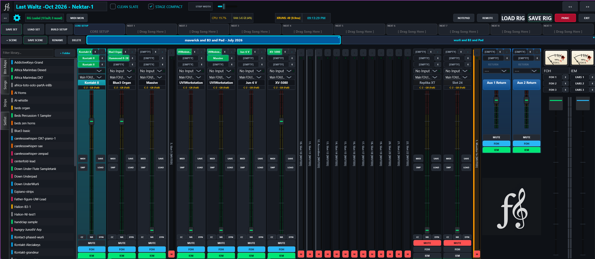
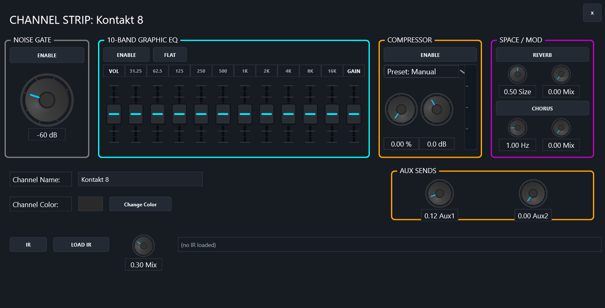

<div align="center">

# Fanfare

### A live performance host for keyboard players

[](https://github.com/openrig-host/openrig/releases/latest)
[](https://github.com/openrig-host/openrig/releases)
[](https://www.gnu.org/licenses/gpl-3.0.html)

A rack-based VST3 host and MIDI router for playing live. No dropouts, no stuck notes, no failed song changes.

[Download](#download) · [Getting Started](GETTING_STARTED.md) · [Features](#features) · [How It Works](#how-it-works) · [VST3 Plugins](#vst3-plugins) · [Make It Yours](#make-it-yours)

<br/>



</div>

> ### Made for the gig
>
> Fanfare runs your rig like a rack of hardware. Fixed channels, real-time audio threads that never wait on a lock, memory allocated up front, and song changes that either finish completely or don't happen at all.
>
> DAWs are for writing. This is for playing.

---

## What is Fanfare?

Fanfare is a Windows app that hosts VST3 instruments and effects in a fixed rack, the way hardware works. No virtual patch cables, no node graphs, no wires to drag around.

What it does on stage:

- **Splits, sample triggers, arpeggiators, octaves, and harmonizers.** Set them up once and forget about them.
- **Song changes load in the background.** The switch is atomic. If anything goes wrong, the current song keeps playing.
- **FOH and IEM are separate mixes.** Every slot sends to each one independently.
- **No stuck notes.** The panic button kills all MIDI within one audio block. Instrument swaps fade the old sound and release held notes cleanly.
- **Your mod wheel only hits the plugin you want.** Per-slot MIDI channel routing, CC remapping, and arm-then-wiggle CC learn.
- **Buttons can act like switches.** Any CC binding can latch, for parameters, mutes, or A/B swaps.
- **Hardware synths are welcome.** Any slot can send MIDI out to an external module instead of hosting a VST.
- **The next song is ready before you call it.** Setlists preload the next rig while you play.
- **Break music is handled.** A dual-deck player with playlists, BPM display, YouTube downloads, and cue trimming.

It's not a DAW. It's an instrument.

---

## Quick Start

1. **Download the latest release.** Grab `Fanfare.exe` from [GitHub Releases](https://github.com/openrig-host/openrig/releases/latest). No installer.
2. **Set up audio and MIDI.** Open `Settings`, pick your **ASIO** driver (or WASAPI), and enable your MIDI controller.
3. **Load a rig or fill a slot.** Click **LOAD RIG** to open a setlist or song, or click **[EMPTY]** on any slot to load a VST3.
4. **Set key ranges and MIDI mappings.** Click **NR** on a strip to set a split by playing the notes, or **CC** to open the CC Assignment Manager.

> The full walkthrough is in **[GETTING_STARTED.md](GETTING_STARTED.md)**.

---

## Features

### The Rack
- **24 fixed slots.** One instrument per slot, always in the same order.
- **FOH, IEM, and direct outs.** Separate FOH (1-2) and IEM (3-4) levels, mutes, and enables on every slot, plus direct hardware outputs (5, 6, 7, 8) for things like a vocal mic or a dry send.
- **Input channel modes.** Switch any slot between Stereo, Mono (L+R), Mono (Left), and Mono (Right).
- **Per-slot MIDI routing.** A global default, overridable per slot.
- **Instrument stacking.** Several instances of the same plugin in one slot, each with its own level, note range, and on/off.
- **Dark UI.** Hardware-style controls and no cable clutter.

### Songs, Scenes, and Setlists
- **Songs (Rigs).** Full patches saved as versioned JSON.
- **Scenes.** Verse, chorus, and bridge variations you can recall by hand or by MIDI.
- **Setlists.** Ordered song lists with one-click load and automatic preload of the next song.
- **Atomic transitions.** New rigs are built and checked off-thread, then swapped in all at once.
- **Automatic rollback.** If a load fails, the current rig keeps playing.
- **Clean-slate mode.** Fully unload the old rig before loading a heavy one.

### MIDI
- **Arm-then-wiggle CC learn.** Click Learn, move a control, done.
- **Latch mode (TOG).** Turn any binding into a toggle.
- **Mute toggles.** Bind strip mutes to a CC.
- **Instrument swap.** Flip between two loaded instruments without unloading either.
- **Long-press learn.** Hold MUTE, FOH, or IEM to start learning that control.
- **Scene triggers.** Assign a Program Change and channel to any scene.
- **MIDI monitor.** See exactly what your controller is sending.
- **MIDI out slots.** Send filtered MIDI to hardware instead of a plugin.

### DSP and Effects


- **Channel strip on every slot.** Noise gate, EQ, compressor, chorus, and convolution reverb.
- **Musette detuner.** Accordion-style MM (2-reed) and MMM (3-reed) detuning that keeps the attack dry, plus **"TEMU Musette"**, a deliberately cheap, wildly out-of-tune setting for when the song needs it.
- **Direct hardware outs.** Send a slot straight to an interface output (for example, Out 5 on a UMC1820) while keeping its FOH and IEM sends independent.
- **Sampler with waveform editor.** Load a WAV and trim it to the sample.
- **Arpeggiator.** Up, Down, Up-Down, and Random, locked to BPM.
- **Octave harmonizer.** Add sub and upper octaves.
- **MIDI effects.** Transposer and more, per slot.
- **Master FX.** Reverb, EQ, and compression on the main buses.

### Between Sets
- **Dual-deck break music player.** BPM display, gain, cue trimming, and playlist arranging.
- **YouTube grab.** Paste a link and the MP3 lands in your playlist.
- **Music library.** Built-in SQLite database with CSV, JSON, and M3U export.
- **Gig notepad.** Notes for each show, right next to the rig.
- **Web remote.** Control it from a phone or tablet on the same network.

### Reliability
- **Panic button.** All Notes Off to every plugin in the next audio block.
- **Parallel loading.** Plugins load at the same time, with safe handling for plugins that need it.
- **Safe saves.** Files are written atomically and backed up automatically.
- **Crash containment.** A misbehaving VST3 doesn't take down the show.
- **Per-plugin isolation.** One plugin failing doesn't stop the audio.
- **Rig migration.** Older rig files upgrade automatically. Files from newer versions are refused instead of half-loaded.

### Engine and CPU Optimization (New in v1.2)
- **Lock-free Parallel Work-Sharing DSP.** Persistent real-time DSP helper threads share active instrument slots with the ASIO audio thread itself using lock-free atomics. There are no mutexes, no heap allocations on the audio thread, and no `ThreadPool` dropped-job stalls. Active worker count scales automatically to one worker per physical Performance core.
- **Hybrid CPU Core Split (P-Cores for Audio, E-Cores for Everything Else).** On Intel 12th Gen and newer hybrid laptops, real-time ASIO and DSP threads are pinned exclusively to fast Performance cores while the UI, graphics rendering, plugin disk streaming, and background setlist preloading run on Efficiency cores. Preloading the next song never steals cycles from live audio.
- **CPU Core 0 Interrupt Shielding.** Keeps real-time audio off Core 0, where Windows and laptop firmware dump Wi-Fi, USB hub, ACPI, and battery-polling driver interrupts (DPCs).
- **Clean Priority Tiering Without MMCSS Storms.** Runs the host in `Above Normal` priority class (and automatically restores it if an ASIO driver elevates the process) so internal plugin background threads stay safely below Priority-15 DSP helpers and Priority-24 ASIO without triggering Windows MMCSS 80% CPU throttling.
- **In-App Engine & CPU Tuning Panel.** Open `Settings` and click `ENGINE & CPU TUNING` for plain-English controls covering Hybrid P-Core pinning, Core 0 shielding, Windows 11 EcoQoS blocking, Parallel vs. Sequential processing, and an AC power stage advisory so players on Intel Hybrid, AMD Ryzen, or older CPUs can dial in their machine.
- **One-Click XRUNS Telemetry.** False-positive counter spikes during audio driver startup and active song swaps are suppressed. Click `XRUNS:` in the top bar anytime to zero the counter and inspect `audio_underrun_log.txt`.

### Where your data lives
Everything is under `%APPDATA%/Fanfare/`:

| Folder | Contents |
|---|---|
| `songs/` | Rig files (`.json`) |
| `sets/` | Setlists |
| `backups/` | Rotating `.bak` copies of rigs |
| `settings/` | Preferences and MIDI maps |

The `.exe` is self-contained. Icons are built in, so there are no extra files to keep track of.

---

## How It Works

```
                       Keyboard
                                │ MIDI
                                ▼
        ┌──────────────────────────────────────┐
        │            Fanfare Engine            │
        │   ┌─────┬─────┬─────┬─────┬─────┐   │
        │   │ S0  │ S1  │ S2  │ S3  │ ... │   │  ← Linear rack
        │   │ Mon │Kbd  │Organ│VSTi │Aux  │   │     (no cables)
        │   └─────┴─────┴─────┴─────┴─────┘   │
        │         │ FOH       │ IEM            │  ← Dual bus
        │         ▼           ▼                │
        │   Master FOH    Master IEM           │
        │     FX bus        FX bus             │
        └──────┬──────────────┬────────────────┘
               │              │
               ▼              ▼
           FOH Out        IEM Out
```

**What happens when you change songs:**

1. `SetlistManager` calls `RigTransitioner::transitionToFile(nextSong)`.
2. `RigBuilder` loads the new rig's plugins in parallel on worker threads.
3. Each new plugin is tested with a silent `processBlock`.
4. The transitioner takes the lock, swaps pointers, and lets go.
5. The old rig unloads. The new one is live.
6. If anything failed along the way, the swap never happens and the current rig keeps playing.

---

## VST3 Plugins

Fanfare handles the quirks of the big plugin makers for you: Native Instruments and Roland plugins restore on the GUI thread, plugins that throw during load are caught and skipped, and plugins that hang are timed out. These are in the built-in plugin list and are used on stage:

| Plugin | Vendor | Type |
|---|---|---|
| **Hammond B-3X** | Hammond / SkyLabs | Tonewheel organ, with split and pedal note-range filters |
| **Kontakt 8** | Native Instruments | Sampler |
| **Super 8** | Native Instruments | Polysynth |
| **Supercharger GT** | Native Instruments | Tube compressor |
| **Omnisphere** | Spectrasonics | Synth |
| **UVI Workstation** | UVI | Sampler |
| **Syntronik 2** | IK Multimedia | Vintage synth collection |
| **JUNO-106** | Roland Cloud | Polysynth |
| **ZENOLOGY** | Roland Cloud | ZEN-Core synth |
| **XV-5080** | Roland Cloud | PCM rompler |
| **Jun-6 V** | Arturia | Polysynth |
| **Replika XT** | Native Instruments | Delay |
| **Chorus JUN-6** | Arturia | Chorus |
| **Pre 1973** | Arturia | Preamp |
| **Pre TridA** | Arturia | Preamp |
| **Bus EXCITER-104** | Arturia | Exciter |
| **Bus FORCE** | Arturia | Bus processor |
| **Bus PEAK** | Arturia | Limiter |
| **MixBox** | IK Multimedia | Channel strip and multi-FX |
| **Blue3 Organ** | Cherry Audio | Tonewheel organ |
| **PolyMax** | Universal Audio | Polysynth |
| **bx_meter (VU)** | Brainworx | Metering |
| **bx_console Focusrite SC** | Brainworx | Channel strip |
| **TR5 Metering** | IK Multimedia | Metering |
| **TR5 British Channel** | IK Multimedia | Channel strip |
| **TR5 White Channel** | IK Multimedia | Channel strip |
| **EZkeys 2** | Toontrack | Pianos |

### Hardware

Used on stage with:

- **MIDI controllers:** Yamaha CK88, Roland RD-88, Nektar LX61+, Arturia KeyLab 88 Essential. Any class-compliant USB MIDI keyboard works.
- **Audio interfaces (ASIO):** Yamaha Steinberg USB ASIO (CK88), Behringer UMC1820, Behringer UMC204HD, AKAI EIE Pro. Any interface with an ASIO driver works.

---

## Download

Windows builds with **ASIO support** are on the [Releases page](https://github.com/openrig-host/openrig/releases). It's a single `Fanfare.exe`. Download it and run it.

> Releases are built with ASIO enabled and uploaded to GitHub directly. There's no CI build because Steinberg's ASIO SDK license doesn't allow it to live in a public repo or on a public build server.

**Latest release:** https://github.com/openrig-host/openrig/releases/latest

### Requirements
- Windows 10 or 11 (64-bit)
- An audio interface or sound card
- An **ASIO driver** for your interface (recommended for live use). Without one, Fanfare uses WASAPI.

### Building it yourself

> **ASIO SDK licensing:** The Steinberg ASIO SDK can't be included in this repo. To build with ASIO, download the SDK from the [Steinberg Developer Portal](https://www.steinberg.net/developers/) and put the headers here:
> ```
> C:\JUCE\modules\juce_audio_devices\native\asio\
> ```
> It has to be that exact path, because that's where the project's `AppConfig.h` looks for it.

You'll need:
1. **Visual Studio 2022 or later** with the "Desktop development with C++" workload
2. **[JUCE 8](https://juce.com)** installed at `C:\JUCE`
3. **Steinberg ASIO SDK**, placed as described above

Open `Builds\VisualStudio2026\Fanfare.sln`, set **Release / x64**, and build. You'll get `Fanfare.exe`.

For the CMake build without ASIO, command-line MSBuild, and troubleshooting, see **[BUILDING.md](BUILDING.md)**.

---

## Make It Yours

**All the source is here. Fork it, change it, ship your own version.**

Fanfare was built with AI coding tools: [Antigravity](https://antigravity.dev) and KiloCode, using Gemini, Claude, Minimax, Zai, and Xiaomi models. You can keep going the same way.

1. **Get the source.** Use the green "Code" button and "Download ZIP", or `git clone`.
2. **Unzip it.**
3. **Open the folder in Antigravity**, or any AI coding agent that can work with C++ and JUCE.
4. **Ask for what you want.** For example:
   - *"Add a new VST to the plugin registry in FanfareEngine.h."*
   - *"Add VST2 hosting alongside VST3."*
   - *"Add a transpose knob to the channel strip."*
   - *"Port this to JUCE 9 when it comes out."*
   - *"Add support for my controller."*
5. **Keep going.** The agent sees the whole codebase, so it can make real changes.

You'll need the build setup from [BUILDING.md](BUILDING.md): Visual Studio, JUCE, and the ASIO SDK if you want ASIO.

**Pull requests are welcome but not required.** If you distribute a modified version, though, the [GPL v3](LICENSE) requires you to publish your source.

---

## Philosophy

1. **Predictable beats flexible.** Slots are fixed. Routing is fixed. The same key makes the same sound every time.
2. **When something fails, nothing changes.** A failed song switch leaves the current rig playing. A crashed plugin leaves the other slots playing. The panic button works in the next audio block.
3. **Heavy lifting happens in the background.** Loading, preloading, and saving stay off the audio thread and out of your way.
4. **Your files are yours.** Rigs are JSON. Backups are automatic. No cloud, no account, no telemetry. Your setlist is a folder you can open, edit, and back up however you like.

---

## Roadmap

- [x] **Themes.** Five to choose from, including a light theme
- [x] **Parallel plugin loading**, with GUI-thread restore for NI plugins
- [x] **CC latch and toggle, mute toggles, long-press learn, instrument swap**
- [ ] **HiDPI layout** for high-resolution stage screens
- [ ] **Out-of-process plugin hosting**, so each plugin runs in its own process
- [ ] **Touch mode** for a tablet as a second screen

---

## License

**Fanfare is licensed under the [GNU General Public License v3.0](LICENSE).**

GPL v3 was picked on purpose. Steinberg offers the ASIO SDK under GPL v3 as an alternative to its proprietary license, so licensing Fanfare the same way keeps the ASIO builds legal to share.

In practice:
- You can use, study, change, and share Fanfare, including the ASIO builds.
- If you **distribute** a modified version, as a binary or as source, you have to release your changes under GPL v3 too.
- The ASIO SDK itself still can't be included in this repo. Download it yourself as described in [BUILDING.md](BUILDING.md).

## Credits

Built with [JUCE 8](https://juce.com).

Made with [Antigravity](https://antigravity.dev) and KiloCode, using [Gemini](https://deepmind.google/technologies/gemini/), [Claude](https://anthropic.com), Minimax, Zai, and Xiaomi.
